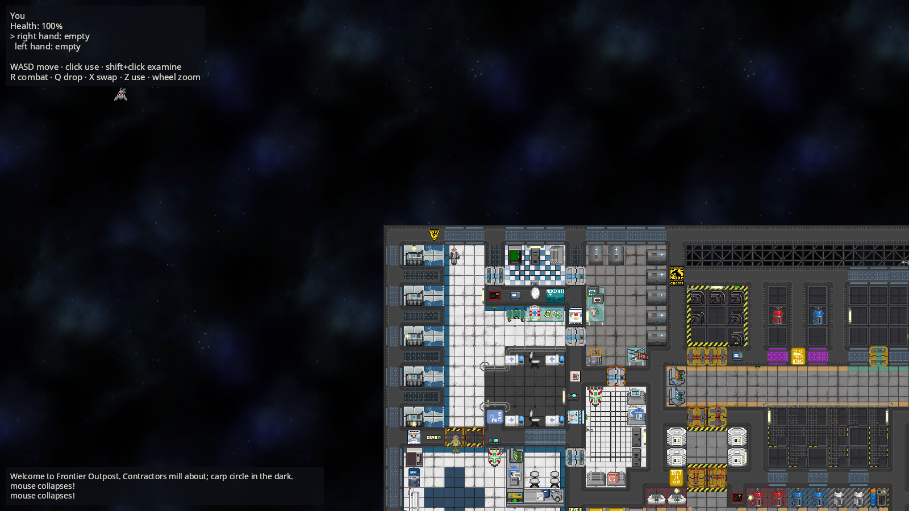

# Caput Mortuum

A from-scratch **Rust** rewrite of [Space Station 14](https://github.com/space-wizards/space-station-14)
and the [Frontier Station](https://github.com/new-frontiers-14/frontier-station-14) fork,
built for **single-player with NPCs**.

> *Caput mortuum* — the "dead head" — is what remains in the alchemist's flask
> after the volatile parts are driven off. It is also the old name for red iron
> oxide: rust. Burn the C# away, and this is what's left.



## What it is

Caput Mortuum reimplements the engine (RobustToolbox) and game systems in Rust,
but **reads upstream content directly**: the same YAML prototypes, map files,
RSI sprite sheets, Fluent locale and `.ogg` sounds that SS14 and Frontier ship.
Nothing is converted or vendored. Point it at an upstream checkout and the
Frontier Outpost loads, airlocks open, contractors walk the halls and space carp
hunt through the hull.

Today it runs:

- **All 35,592 Frontier prototypes** (195 kinds) with Robust's inheritance rules; zero load errors.
- **All 374 upstream maps** (534k entities, 362k tiles, 136k decals) and all 4,244 RSIs.
- A **30 Hz simulation** on `bevy_ecs`: transforms and grids, physics with upstream's
  collision groups, `SharedMoverController` movement, hands and items, melee,
  damage/mob-state/destructibles, doors and airlocks, inventories and clothing.
- **NPCs driven by upstream's HTN task networks**: the `htnCompound` YAML is
  planned by a port of `HTNPlanJob`, with utility-query targeting, A* pathfinding and steering.
- A **Bevy client** drawing it all with upstream sprites: tiles, decals, wall
  smoothing, door animations, humanoids in their clothing, parallax, HUD, sound.

It is early. See [docs/PORTING.md](docs/PORTING.md) for what is ported and
what is not (atmos, power, chemistry, shuttles and much more are still ahead).

## Running it

Requirements: Rust 1.97.1+, and on Linux the usual Bevy system libraries:

```bash
sudo apt install pkg-config libasound2-dev libudev-dev libwayland-dev libxkbcommon-dev
```

```bash
tools/summon-upstream.sh          # fetch pinned Frontier + RobustToolbox content (~1 GB)
cargo run --release -p caput      # play
```

| Key | Action |
|---|---|
| WASD | move (hold Shift to walk) |
| Left click | interact: pick up, open doors |
| Shift + click | examine |
| R | toggle combat mode (click attacks) |
| Q / X / Z | drop / swap hands / use in hand |
| Mouse wheel | zoom |
| F12 | screenshot |

`caput-mortuum --help` lists options: pick the station map, the shuttle parked
alongside, your body prototype, NPC counts, world seed.

## Layout

| Crate | Role | Upstream equivalent |
|---|---|---|
| [`vellum`](crates/vellum) | resource roots, RSI sprite sheets, Fluent locale | `IResourceManager`, RSI loading, `ILocalizationManager` |
| [`grimoire`](crates/grimoire) | YAML data nodes, `!type:` tags, serde, prototypes + inheritance | `Robust.Shared.Serialization`, `PrototypeManager` |
| [`astrolabe`](crates/astrolabe) | tiles, chunked grids, map files, decals, migrations | `MapLoaderSystem`, `MapGrid`, tile definitions |
| [`athanor`](crates/athanor) | the simulation: every ported game system | `Robust.Shared` + `Content.Shared` + `Content.Server` |
| [`homunculus`](crates/homunculus) | NPC minds: HTN planner, utility AI, pathfinding | `Content.Server/NPC` |
| [`caput`](crates/caput) | the Bevy client | `Robust.Client` + `Content.Client` |

Our own content (NPC contractors, starting gear) lives in [`resources/`](resources),
written in upstream's YAML format and layered on top of the upstream roots.

## Testing

```bash
cargo test --workspace
```

Integration tests run against the real upstream content when `upstream/` is
present (they pass trivially without it): every prototype, map and RSI loads;
humans walk into walls and stop; bumped airlocks open; a carp hunts and bites a
human; every Frontier shuttle and POI spawns.

## License

AGPL-3.0, inherited from Frontier Station (see [LEGAL.md](LEGAL.md)). Upstream
SS14 and RobustToolbox code is MIT; their notices are kept in
`LICENSE-MIT-SS14.txt` and `LICENSE-MIT-RobustToolbox.txt`. Content assets are
not part of this repository; they keep their own licenses (mostly CC-BY-SA 3.0)
as recorded in each upstream `meta.json` and `attributions.yml`.
